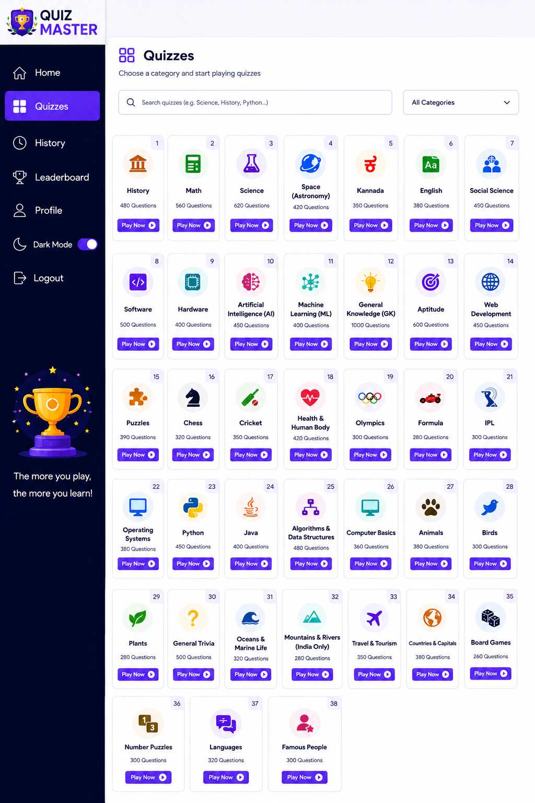
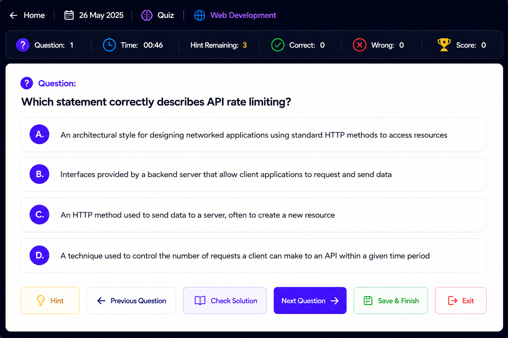
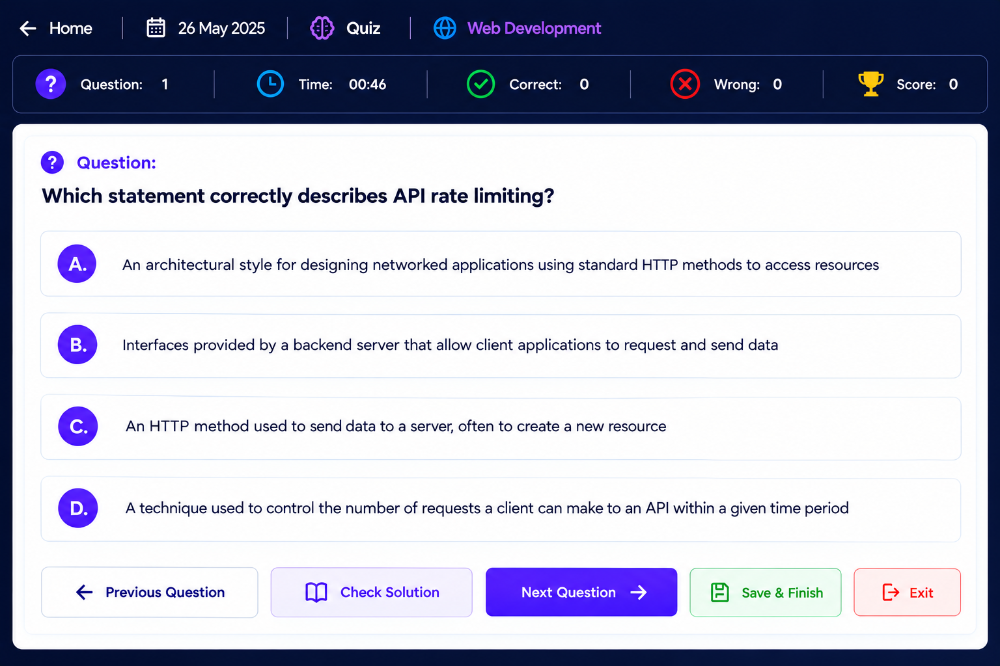
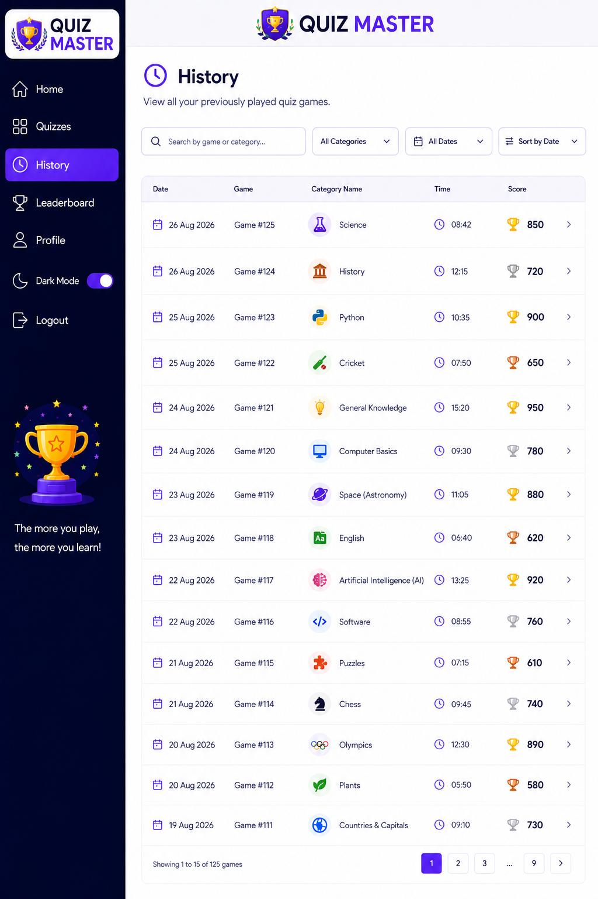
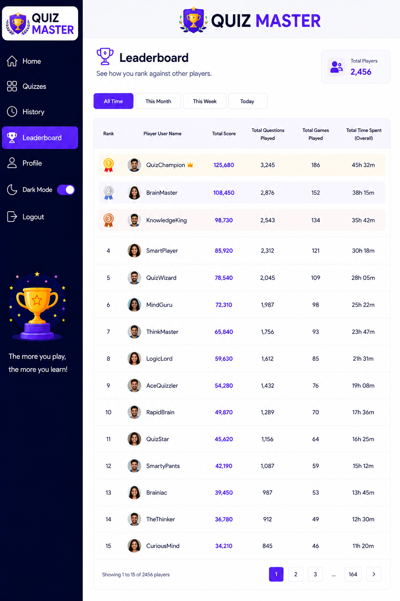
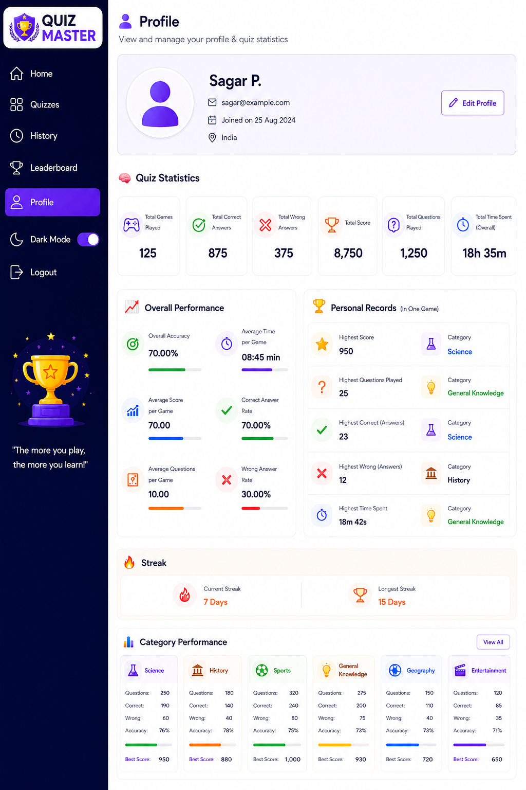
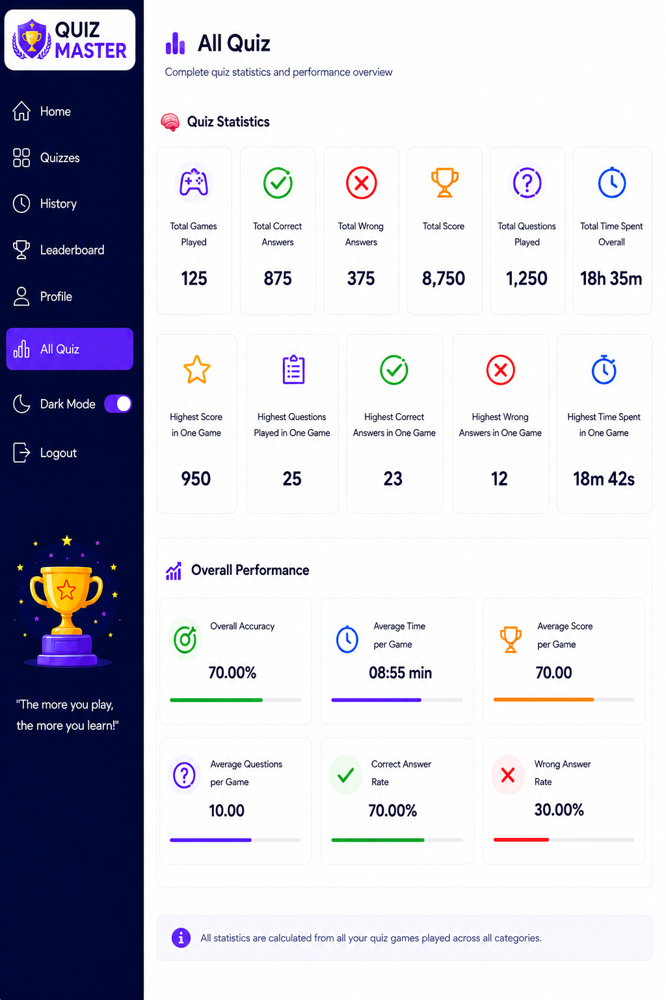

# 🧠 Quiz Master

A full-stack quiz website built with **Flask + SQLite + HTML/CSS/JavaScript**. It has session login with hashed passwords, a REST API, three separate quiz types, per-user progress, history, a leaderboard, a profile with a daily streak, and dark mode.

## Screenshots

| Quizzes | Quiz playing | Daily quiz |
|---|---|---|
|  |  |  |

| History | Leaderboard | Profile | All Quiz |
|---|---|---|---|
|  |  |  |  |

## Quiz types (kept completely separate)

| Type | Where | Dataset | Length |
|---|---|---|---|
| Normal Quiz 1 | Quizzes page (56 categories) | `app/data_source/categories/*.csv.gz` | Unlimited |
| Normal Quiz 2 ("Play All Quiz") | Home page | `normal_quiz_2_part1.csv.gz` + `part2.csv.gz` | Unlimited |
| Daily Quiz | Home → Start Daily Challenge | `daily_quiz.csv.gz` | 50/day, once per day, no hints |

| Page | Shows data from |
|---|---|
| Profile | Normal Quiz 1 only, plus the Daily streak card (current / longest) |
| All Quiz | Normal Quiz 2 only |
| History | All 3 quiz types, for the logged-in user |
| Leaderboard | All 3 quiz types, all users (All Time / Month / Week / Today) |

## Game rules
- Nothing is revealed before you answer. Click an option and you instantly see right/wrong, the correct option and the explanation.
- Scoring: correct **+10**, wrong **−5** (the score never goes below 0). Hints (max 5 in Normal quizzes, none in Daily) reveal the answer and don't change the score.
- Questions are served in order from a per-user pointer, so you continue where you stopped (wrapping around at the end of the dataset).
- A game is saved only when you press **Finish & Save**. **Exit** discards it.
- Daily streak: playing on consecutive days increases it; missing a day resets it.
- **Profile → Clear All Data** wipes only your own history, progress, streaks and scores. Your account stays and other users are unaffected.

## Run locally
```bash
pip install -r requirements.txt
python run.py          # http://127.0.0.1:5000
```
On the first run the datasets (about 712,000 questions) are built into a local SQLite question bank (`instance/questions.db`), which takes roughly 10–20 seconds. Without `DATABASE_URL`, accounts are stored in `instance/quizmaster.db`. **The `.db` file is generated automatically and is never committed to GitHub** (see `.gitignore`).

## Databases
| Data | Where it lives |
|---|---|
| Accounts, progress, streaks, history, scores | **Supabase PostgreSQL** when `DATABASE_URL` is set, otherwise a local SQLite file (`instance/quizmaster.db`) |
| Question bank (about 712,000 questions) | Local read-only SQLite file `instance/questions.db`, rebuilt automatically from `app/data_source/*.csv.gz` (10-20 seconds when it is missing) |

The question bank is never stored in Supabase, so it stays inside the free 500 MB limit. **No `.db` file is committed to GitHub** (see `.gitignore`).

## Deploy on Render with Supabase
1. In Supabase open **Connect** and copy the **Session pooler** connection string (IPv4 compatible, which Render needs). It looks like `postgresql://postgres.<project-ref>:<password>@aws-0-<region>.pooler.supabase.com:5432/postgres`. The direct `db.<ref>.supabase.co` address is IPv6-only and will fail on Render.
2. On Render create a Web Service from the GitHub repo. Build command: `pip install -r requirements.txt`. Start command: `gunicorn run:app --bind 0.0.0.0:$PORT --workers 2 --timeout 180 --preload` (same as the `Procfile`).
3. Environment variables:
   - `DATABASE_URL` = the Supabase connection string (with your real password)
   - `QUIZMASTER_SECRET_KEY` = a long random string
4. Deploy. The tables are created automatically on the first start, and the logs show `User database: Supabase / PostgreSQL`. No persistent disk is needed, because users and history live in Supabase.
5. The first start after every deploy rebuilds the question bank, so the first load takes about 20 seconds.

Never put the database password in the code or in GitHub, only in Render's environment variables.

## Project structure
```
run.py  Procfile  requirements.txt  README.md  .gitignore
screenshots/            README images
app/
  __init__.py           app factory, auto-import on first run
  config.py             settings (env vars, scoring constants)
  db.py                 user DB (PostgreSQL/SQLite) + question bank
  schema_user_*.sql     user tables (SQLite + PostgreSQL versions)
  schema_questions.sql  question bank tables
  import_data.py        gzip CSV importer (supports _partN files)
  categories_meta.py    the 56 categories in order
  quiz_engine.py        start / answer / hint / finish logic
  stats.py              profile, streak and leaderboard queries
  auth.py  routes.py  api.py
  data_source/          gzip datasets (GitHub-safe)
  templates/  static/
```

## Notes
- Passwords are hashed with Werkzeug. Sessions use a signed cookie. Set `QUIZMASTER_SECRET_KEY` in production.
- The data layer uses raw SQL with `sqlite3` locally and `psycopg` (PostgreSQL) when `DATABASE_URL` is set.
- Files are read with explicit UTF-8, so it also runs on Windows.
